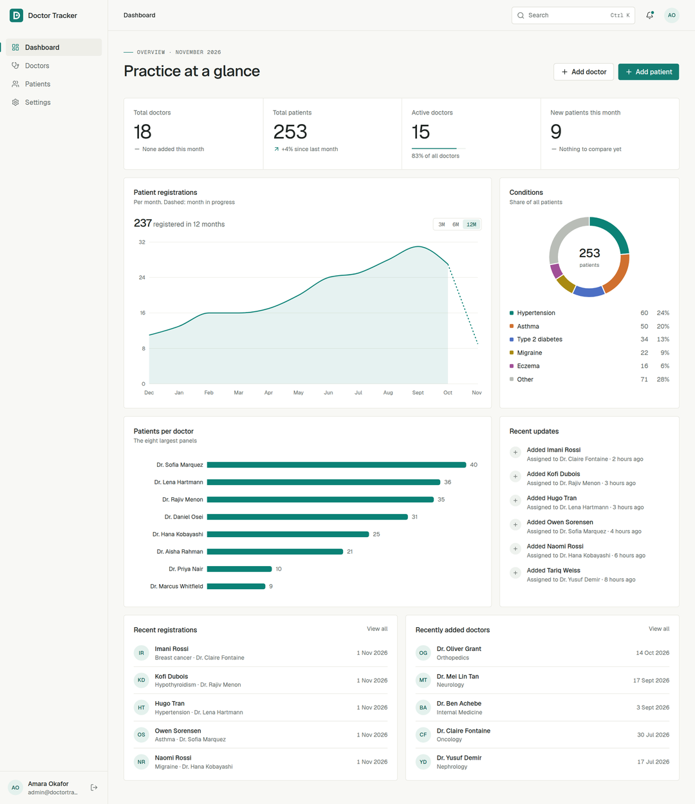
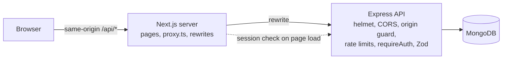
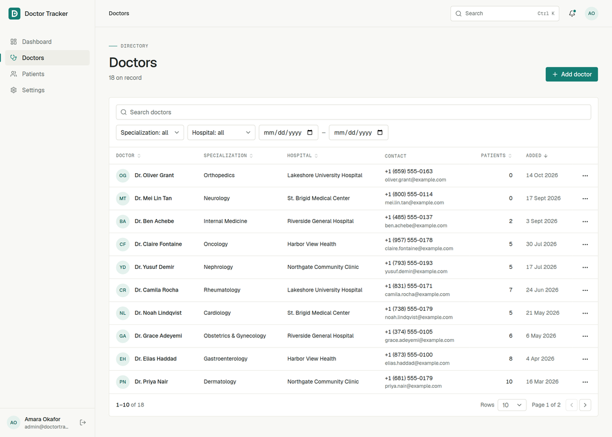
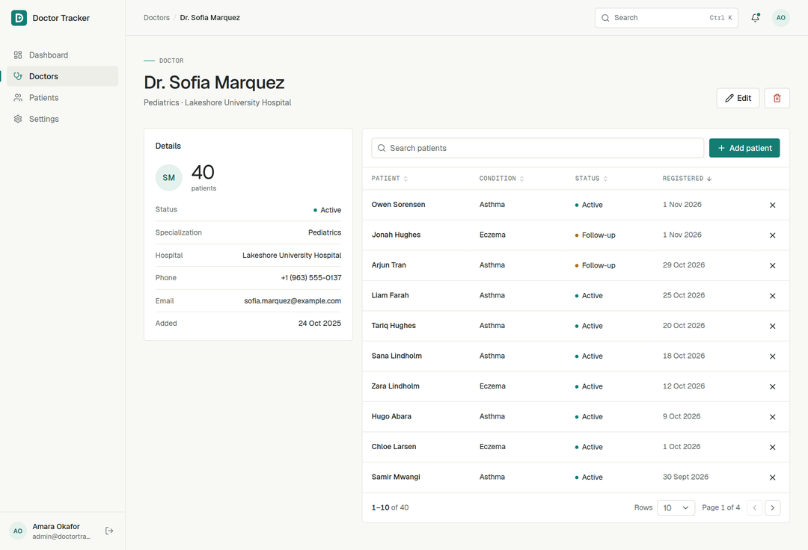
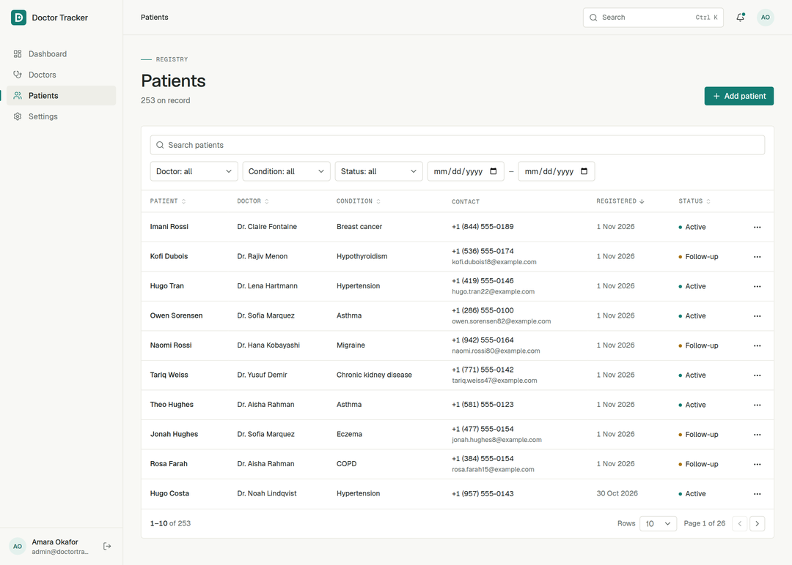
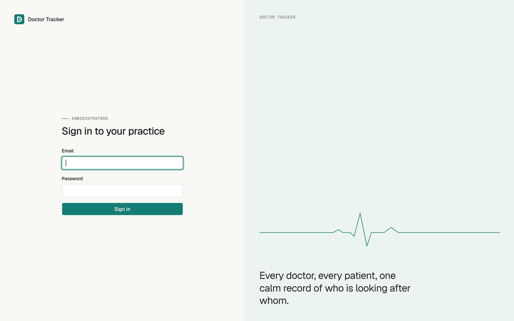
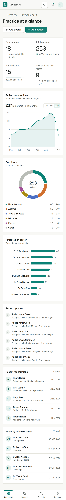
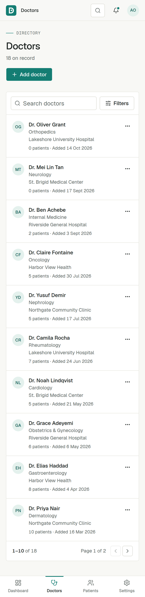
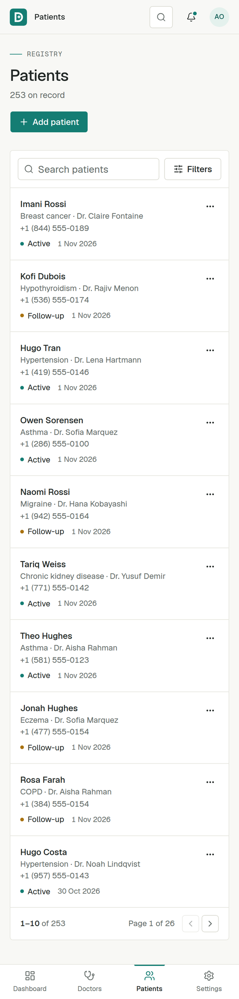
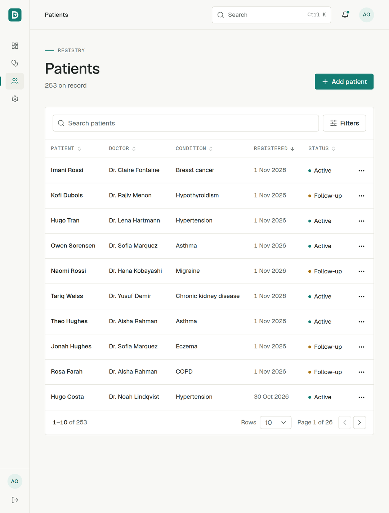

# Doctor Tracker

**A calm, precise console for clinic administrators: every doctor, every patient, and who is looking after whom.**
**Live application:** https://client-omega-two-98.vercel.app/

**Source code:** https://github.com/RimonDipta/doctor-tracker

> **Demo login**
>
> - Email: `admin@doctortracker.dev`
> - Password: `DemoAdmin2026!`
>
> These credentials are for the demo environment only. Do not use them for a real deployment.

Doctor Tracker replaces the spreadsheet a practice manager keeps of doctors and their patient panels. Administrators sign in, manage both directories, reassign patients safely, and read the state of the practice from a dashboard built on live aggregations. It is an administrative tool: it holds contact details and a condition label, never clinical notes.



## Project overview

Doctor Tracker is a web app for clinic administrators who need one place to manage doctors and their patients. Administrators can sign in, maintain doctor and patient records, search and filter lists, and use the dashboard to understand registrations and patient distribution. The app uses fictional demo records and is intended as a portfolio project, not as a certified healthcare system.

## Contents

- [Features](#features)

- [Technology stack](#technology-stack)

- [Local setup](#local-setup)

- [Environment variables](#environment-variables)

- [Database](#database)

- [Admin accounts](#admin-accounts)

- [Architecture and data flow](#architecture-and-data-flow)

- [API reference](#api-reference)

- [Technical decisions](#technical-decisions)

- [Screenshots](#screenshots)

- [Testing](#testing)

- [Deployment](#deployment)

- [Known limitations](#known-limitations)

## Features

**Dashboard.** Totals with period comparisons, patients per doctor, registrations over 3, 6 or 12 months, condition mix, recent registrations, recent doctors, an activity feed and quick actions. Every number comes from a server aggregation. Month-to-date figures are compared with the same stretch of last month, and the month in progress is drawn dashed so a new month doesn't read as a collapse.

**Doctors and patients.** Full create, read, update and delete, with detail pages, server-side search, filtering, sorting and pagination. List state lives in the URL, so a filtered view can be refreshed or shared. Forms validate inline and show server errors on the field that caused them.

**Safe deletion.** A doctor with patients can't be deleted until someone is named to take them over. The dialog asks for the successor and the API enforces it.

**Across the app.** Global search (`Ctrl/⌘ K`), a notification popover fed by the activity log, loading, empty and error states everywhere, keyboard navigation, and layouts for desktop, tablet (icon rail) and phone (bottom navigation, tables become cards).

**Security.** Session cookies that are HTTP-only and SameSite, hashed session tokens, bcrypt passwords, rate limiting per IP and per account, an Origin check on writes, Zod validation on every input, and protected routes on both the frontend and the API.

## Technology stack

| Layer          | Choice                                                        |
| -------------- | ------------------------------------------------------------- |
| Frontend       | Next.js 16 (App Router), React 19, TypeScript, Tailwind CSS 4 |
| UI             | shadcn/ui (customized), Lucide icons, Recharts, Geist         |
| Data and forms | TanStack Query, React Hook Form, Zod                          |
| Backend        | Node.js, Express 5, TypeScript                                |
| Database       | MongoDB with Mongoose                                         |
| Auth           | Server-side sessions in HTTP-only cookies, bcrypt             |
| Tests          | Vitest, Supertest, mongodb-memory-server                      |

## Local setup

Requires **Node.js 20 or later**.

```bash
# 1. Install

cd server && npm install
cd ../client && npm install
# 2. Configure

cp server/.env.example server/.env
cp client/.env.example client/.env.local
# 3. Start MongoDB (skip if you already run one on port 27017)

cd server && npm run db:local
# 4. In a second terminal: load demo data, then start the API on :4000

cd server && npm run seed && npm run dev
# 5. In a third terminal: start the frontend on :3000

cd client && npm run dev
```

Open <http://localhost:3000> and sign in with the [demo account](#admin-accounts).

## Environment variables

The committed templates are [`server/.env.example`](server/.env.example) and [`client/.env.example`](client/.env.example).

**Server**

| Variable              | Default                                    | Purpose                                                         |
| --------------------- | ------------------------------------------ | --------------------------------------------------------------- |
| `NODE_ENV`            | `development`                              | `production` turns on secure cookies and blocks the seed script |
| `PORT`                | `4000`                                     | API port                                                        |
| `MONGODB_URI`         | `mongodb://127.0.0.1:27017/doctor-tracker` | Database connection                                             |
| `CLIENT_ORIGIN`       | `http://localhost:3000`                    | Allowed browser origin(s), comma-separated. Must match exactly  |
| `SESSION_TTL_DAYS`    | `7`                                        | Sliding session lifetime                                        |
| `COOKIE_SECURE`       | on in production                           | Override the cookie's `Secure` flag                             |
| `TRUST_PROXY`         | `1`                                        | Reverse proxies in front of the API                             |
| `SEED_ADMIN_PASSWORD` | `DemoAdmin2026!`                           | Demo admin password used by the seed                            |

**Client**

| Variable  | Default                 | Purpose                                                                                                             |
| --------- | ----------------------- | ------------------------------------------------------------------------------------------------------------------- |
| `API_URL` | `http://localhost:4000` | Express API, as seen from the Next.js server. Rewrites are compiled at build time, so set it before `npm run build` |

## Database

Any MongoDB 5.0 or later works. The options, easiest first:

- **`npm run db:local`** in `server/` runs a real `mongod` with no install. The binary downloads on first run and data persists in `server/.mongo-data`.

- **Docker:** `docker run -p 27017:27017 mongo:8`

- **MongoDB Atlas (recommended for deployment):**
  1. Create a dedicated Atlas project and cluster, then create a **database user** (not your Atlas account login).

  2. In **Network Access**, allow the IP address of your deployed API host. Avoid `0.0.0.0/0` except for temporary testing; never expose the database publicly without a strong database password.

  3. In **Database → Connect → Drivers**, copy the Node.js connection string. Replace `<db_password>` with the database user's password (URL-encode special characters), and include the database name `doctor-tracker`.

  4. Set the full URI as `MONGODB_URI` in the API host's secret environment variables. Do not commit it or put it in a `NEXT_PUBLIC\_*` variable.

  5. Confirm `/api/health` reports `database: connected` after deployment. Atlas creates the database and collections on first write; schema indexes are declared by Mongoose.

  Example:

  ```env
  MONGODB_URI=mongodb+srv://<db-user>:<encoded-password>@<cluster>.mongodb.net/doctor-tracker?retryWrites=true&w=majority&appName=doctor-tracker
  ```

`npm run seed` replaces all doctors, patients and activity with 18 doctors and about 250 patients spread over 14 months. Everyone in it is fictional, emails use `example.com`, and phone numbers use the reserved 555-01xx range. The seed is deterministic and relative to today's date, and it refuses to run with `NODE_ENV=production` unless passed `--force`.

Indexes are declared on the Mongoose schemas and built on startup.

## Admin accounts

After seeding:

| Email                     | Password         |
| ------------------------- | ---------------- |
| `admin@doctortracker.dev` | `DemoAdmin2026!` |

These are public demo credentials. Never seed them into a real deployment. To create a real administrator, or reset one's password:

```bash
cd server
npm run create-admin -- --name "Jo Rivera" --email jo@clinic.org --password "a-long-passphrase"
```

There is deliberately no sign-up page: only someone with database access can create an administrator.

## Architecture and data flow



```text
client/                 Next.js frontend
  app/                  Routes. (app)/ is everything behind sign-in
  components/
    ui/                 shadcn primitives, restyled
    data/               Tables, toolbars, pagination, states, dialogs
    forms/ layout/      Form fields; shell, navigation, search
    dashboard/ doctors/ patients/
  hooks/ lib/           URL state, API client, query hooks, schemas
  proxy.ts              Redirects signed-out visitors
server/                 Express API
  src/modules/          auth, doctors, patients, dashboard, search, activity
  src/models/           Admin, Session, Doctor, Patient, Activity
  src/middleware/       Auth, rate limits, origin guard, errors
  scripts/              seed, create-admin, local-db
  tests/                API tests against a real mongod
```

**A list request.** Typing in a search box updates local state. After 300 ms the term is written to the URL with `history.replaceState`, which changes the TanStack Query key. The hook fetches `/api/doctors?...`, keeping the previous page on screen at reduced opacity. Next rewrites the call to Express, which rate limits it, validates the session, parses the query with Zod and runs one aggregation.

**A write.** Dialog forms validate with Zod, then call a mutation. On success, every doctor, patient, dashboard, activity and search query is invalidated, because one write can move any of those numbers. Field errors from the API are mapped back onto their inputs. Only the patient status control updates optimistically: it is one reversible field, and it rolls back if the server refuses.

**Page protection** has three layers. `proxy.ts` redirects when no cookie exists, which is fast but proves nothing. The `(app)` layout then validates the session against the API. Finally, every API route validates independently, and this is the layer that actually protects the data.

### Response shape

```jsonc
{ "data": { */* resource */* } }                      *// single resource*
{ "data": [ */* rows */* ], "meta": { "page": 1, "limit": 10, "total": 18, "totalPages": 2 } }
{ "error": { "code": "VALIDATION_ERROR", "message": "…", "details": { "fieldErrors": { "email": "…" } } } }
```

## API reference

Everything except login, logout and health requires the session cookie.

### Auth

| Method | Path                        | Notes                                                        |
| ------ | --------------------------- | ------------------------------------------------------------ |
| POST   | `/api/auth/login`           | `{ email, password }`. Sets the cookie. Rate limited         |
| POST   | `/api/auth/logout`          | Deletes the session. `204`                                   |
| GET    | `/api/auth/me`              | Current admin                                                |
| PATCH  | `/api/auth/me`              | `{ name, email }`                                            |
| POST   | `/api/auth/change-password` | `{ currentPassword, newPassword }`. Signs out other sessions |

### Doctors

| Method | Path                        | Notes                                                                                                                                                                                           |
| ------ | --------------------------- | ----------------------------------------------------------------------------------------------------------------------------------------------------------------------------------------------- |
| GET    | `/api/doctors`              | Query: `page`, `limit` (max 100), `search`, `specialization`, `hospital`, `status`, `addedFrom`, `addedTo`, `sort` (`name`, `specialization`, `hospital`, `patientCount`, `createdAt`), `order` |
| POST   | `/api/doctors`              | `{ name, specialization, hospital, phone, email, status? }`                                                                                                                                     |
| GET    | `/api/doctors/filters`      | Distinct specializations and hospitals                                                                                                                                                          |
| GET    | `/api/doctors/options`      | Lightweight list for pickers                                                                                                                                                                    |
| GET    | `/api/doctors/:id`          | Includes `patientCount`                                                                                                                                                                         |
| PATCH  | `/api/doctors/:id`          | Any subset of fields                                                                                                                                                                            |
| DELETE | `/api/doctors/:id`          | `?reassignTo=<doctorId>` is required if the doctor has patients, otherwise `409 DOCTOR_HAS_PATIENTS`                                                                                            |
| GET    | `/api/doctors/:id/patients` | Same query as `GET /api/patients`                                                                                                                                                               |
| POST   | `/api/doctors/:id/patients` | Creates a patient under this doctor                                                                                                                                                             |

### Patients

| Method | Path                    | Notes                                                                                                                                                                              |
| ------ | ----------------------- | ---------------------------------------------------------------------------------------------------------------------------------------------------------------------------------- |
| GET    | `/api/patients`         | Query: `page`, `limit`, `search`, `doctor`, `condition`, `status`, `registeredFrom`, `registeredTo`, `sort` (`fullName`, `doctor`, `condition`, `status`, `registeredAt`), `order` |
| GET    | `/api/patients/filters` | Distinct conditions                                                                                                                                                                |
| GET    | `/api/patients/:id`     | Includes the doctor reference                                                                                                                                                      |
| PATCH  | `/api/patients/:id`     | Any subset of fields. Setting `doctor` reassigns                                                                                                                                   |
| DELETE | `/api/patients/:id`     | `204`                                                                                                                                                                              |

Patient body: `{ fullName, dateOfBirth, gender, phone, email?, address, condition, status?, registeredAt? }`. Dates are `YYYY-MM-DD`.

### Other

| Method | Path                   | Notes                                                   |
| ------ | ---------------------- | ------------------------------------------------------- |
| GET    | `/api/dashboard/stats` | Metrics, chart series, recent records, activity         |
| GET    | `/api/activity`        | `?limit=` (max 50)                                      |
| GET    | `/api/search`          | `?q=` (min 2 characters). Top five doctors and patients |
| GET    | `/api/health`          | Public. `503` if the database is disconnected           |

### Status codes

`200`, `201`, `204` on success. `400` validation or malformed id, `401` no valid session, `403` foreign origin, `404` not found, `409` duplicate email or doctor with patients, `429` rate limited, `500` unexpected (details are logged, not returned).

## Technical decisions

### 1. One origin, with sessions the server can revoke

The obvious design is a JWT in a cookie, with the browser calling the API on its own domain. I rejected both halves of that.

**Sessions over JWTs.** A JWT can't be revoked before it expires without adding a server-side denylist, at which point it has lost its one advantage. For a tool holding patient details, "sign out" and "password changed, so kick everyone else out" must take effect immediately. So a session is a random 256-bit token in the cookie, with only its SHA-256 hash stored in MongoDB. Someone who reads the database still can't use the sessions they find. A TTL index expires old rows, and sessions slide forward once past half their lifetime. The cost is one indexed lookup per request, which is negligible here.

**Same origin through a rewrite.** Next rewrites `/api/*` to Express, so the browser only ever talks to one origin. If the frontend and API sat on different sites, the cookie would be third-party, needing `SameSite=None`. That gives up the browser's built-in CSRF protection, and third-party cookies are increasingly blocked outright. With the rewrite, the cookie is first-party and `SameSite=Lax` holds wherever the API is hosted. It also makes the cookie visible to Next, so a signed-out visitor is redirected before any page renders. The trade-offs are an extra hop and a build-time `API_URL`. CORS and an Origin check remain as a second layer for anyone calling the API directly.

### 2. Compute patient counts on read, placing the join after the page

The doctor table shows a patient count on every row and can sort by it. The common shortcut is a `patientCount` field on each doctor, incremented on writes. But every path that moves a patient would then have to maintain it, including bulk reassignment during deletion, and without multi-document transactions a crash would leave counts quietly wrong. Queries for one row per doctor would be correct but would be the N+1 this project is meant to avoid.

Instead, the patient collection stays the only source of truth and a single aggregation does the work. The position of the `$lookup` is the key detail:

```text
sort by name:         $match → $sort → $skip → $limit → $lookup count
sort by patientCount: $match → $lookup count → $sort → $skip → $limit
```

Normally the count is computed for only the 10 rows on screen, using the `{ doctor }` index. Only sorting by count pays for counting every doctor, and it's a cost that can't be avoided short of denormalizing. With a directory of hundreds of doctors that's well within reason, and if it ever weren't, a cached count could be added then, with the aggregation as the way to rebuild it. The patient list uses the same pattern for its doctor join.

Text indexes follow the same thinking: indexes on name, specialization, hospital and condition use a case-insensitive collation matching the queries, so "cardiology" and "Cardiology" filter, group and sort as one value.

## Screenshots

| Doctors                                          | Doctor details                                         |
| ------------------------------------------------ | ------------------------------------------------------ |
|  |  |

| Patients                                           | Sign in                                        |
| -------------------------------------------------- | ---------------------------------------------- |
|  |  |

| Mobile dashboard                                           | Mobile doctors                                         | Mobile patients                                          | Tablet                                                   |
| ---------------------------------------------------------- | ------------------------------------------------------ | -------------------------------------------------------- | -------------------------------------------------------- |
|  |  |  |  |

## Testing

```bash
cd server && npm test
```

30 API tests run against a real `mongod` (downloaded on first run, so allow a minute). They cover sign-in and session handling, rate limiting including spoofed `X-Forwarded-For`, NoSQL injection attempts, CRUD, search, filtering, sorting and pagination, every path through doctor deletion, and the dashboard's date and comparison logic.

`npm run typecheck` is available in both apps. The frontend has no automated test suite in this repository.

## Production checklist

- Deploy the Express API and Next.js app over HTTPS; set `NODE_ENV=production` for the API.

- Configure `MONGODB_URI`, exact `CLIENT_ORIGIN` (comma-separated only for intentional origins), `COOKIE_SECURE=true`, and the correct `TRUST_PROXY` for your hosting topology.

- Set `API_URL` at Next.js build time to the API's private/reachable URL. Keep it server-side.

- Create the first administrator with `npm run create-admin`; do not seed demo data in production.

- Use a strong unique admin password, rotate it after initial setup, and keep secrets in the host's secret manager.

- Restrict Atlas Network Access to the API host's outbound IPs and use a least-privilege database user.

- Verify health, login, CRUD, password change, HTTPS cookie behavior, backups, and restore procedure before real patient data.

- Treat contact details and condition labels as sensitive personal data. Use fictional records for demos and ensure backups/logs are access-controlled.

## Deployment

The two apps deploy separately. One working combination is MongoDB Atlas, the API on a Node host such as Render, Railway or Fly.io, and the frontend on Vercel.

**1. Database.** Create an Atlas cluster and a database user, and copy the connection string.

**2. API.**

```bash
npm ci && npm run build   *# build*
npm start                 *# run*
```

Set `NODE_ENV=production`, `MONGODB_URI`, `CLIENT_ORIGIN=https://your-frontend.example`, and `TRUST_PROXY` to the number of proxies in front of the API. A Next rewrite plus a platform load balancer is usually `2`. Use `/api/health` as the health check.

**3. Frontend.** Set `API_URL` to the public API URL **before building**, then deploy `client/` as the root directory.

**4. First admin.** From a machine that has `MONGODB_URI` set, run `npm run create-admin`. Don't run the seed against production.

## Known limitations

- **Rate limit counters live in memory**, so they reset on restart and aren't shared between instances. Running more than one API instance needs a shared store such as Redis.

- **The per-IP limit depends on the deployment.** Next forwards a client-supplied `X-Forwarded-For` as received, so this limit is only trustworthy behind a platform that overwrites that header. The per-account limit (20 failures per 15 minutes) holds regardless, at the cost that an attacker can temporarily lock an account's sign-in.

- **Doctor deletion isn't a transaction**, because that would require a replica set. Patients move before the doctor is removed and a sweep afterwards catches late additions, so reassignment is safe. A patient created in the instant between the "no patients" check and the delete of a doctor with an empty panel could still be orphaned; the UI would show them as unassigned.

- **Search uses escaped case-insensitive regex**, which allows partial matches but scans the collection. That's fine at thousands of records. Much larger data sets would want Atlas Search.

- **All dates are UTC.** Month boundaries on the dashboard follow UTC, not the clinic's time zone.

- **Not a compliance statement.** The app applies sensible security practices, but real patient data needs a proper review (HIPAA, GDPR or local equivalents), encryption at rest and an audit retention policy. Activity entries expire after 90 days.
